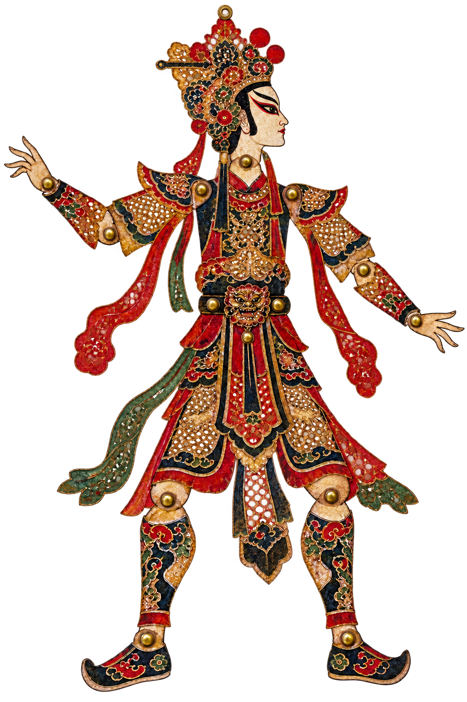

# MingMirror Shadow Play · 明镜影戏

> 用五个指尖牵动一尊中国皮影。A browser-local Chinese shadow-puppet experience controlled by your hand.

<p align="center">
  
</p>

这是一个与 MingMirror 主站解耦的交互实验：摄像头只用于本机手势识别，不展示画面、不上传视频；五个指尖分别牵引皮影的双腕、双踝与冠顶，掌心移动整尊皮影。

This is an independent interaction prototype for MingMirror. Hand landmarks are processed locally in the browser, while the camera feed stays hidden and is never uploaded.

## 体验亮点

- **五指操影**：拇、食、中、无名、小指分别对应五个皮影关节。
- **传统视觉语言**：以灯幕、朱砂、宣纸与皮影雕花构成东方戏台。
- **隐私优先**：摄像头画面不显示，视频帧仅在当前浏览器内处理。
- **手部校准**：只显示抽象骨架和识别状态，不展开真实摄像头画面。
- **安全演示模式**：没有摄像头时，也可以用模拟手势体验完整联动。
- **引擎与场景解耦**：`GestureEngine` 不依赖具体视觉场景，方便后续复用进 MingMirror。

## 五指映射

| 手指 | 皮影关节 |
| --- | --- |
| 拇指 | 左腕 |
| 食指 | 左踝 |
| 中指 | 冠顶 |
| 无名指 | 右踝 |
| 小指 | 右腕 |
| 掌心 | 整体位移 |

画面中的五个标记固定按 **拇 → 食 → 中 → 无 → 小** 从左到右排列，小拇指始终位于最右侧。

## 本地运行

需要 Node.js 20+。

```bash
npm install
npm run dev
```

打开 Vite 输出的本地地址。真实手势需要在 `localhost` 或 HTTPS 环境下授权摄像头；也可以直接选择“观看演示”，不会请求摄像头权限。

## 测试与构建

```bash
npm test
npm run build
npm run preview
```

## 技术栈

- React 19 + TypeScript
- Vite
- MediaPipe Tasks Vision
- SVG 分层关节与双骨骼 IK
- Vitest

## 架构

```text
MediaPipe / Demo Signal
          ↓
     GestureEngine
          ↓
   normalized hand state
          ↓
 Shadow Puppet Scene
```

- `src/gesture/`：平滑、状态机和标准化手势事件。
- `src/components/GestureInput.tsx`：摄像头、演示信号与手部校准。
- `src/components/ShadowPuppet.tsx`：五指到皮影关节的映射和 IK 动画。
- `src/components/ShadowPlayground.tsx`：影戏舞台与中文交互说明。

场景只订阅手势引擎，不直接依赖 MediaPipe，因此未来可以替换输入设备或接入 MingMirror 主站。

## 隐私说明

- 不展示摄像头预览。
- 不录制、不上传、不保存视频帧。
- 手势模型与交互逻辑均在浏览器本地运行。
- 仓库不包含用户数据、密钥或生产环境配置。

## 项目状态

这是一个独立的 Creative Coding 原型，目前用于验证五指与中国皮影的交互体验；尚未合并或部署至 MingMirror 正式网站。

